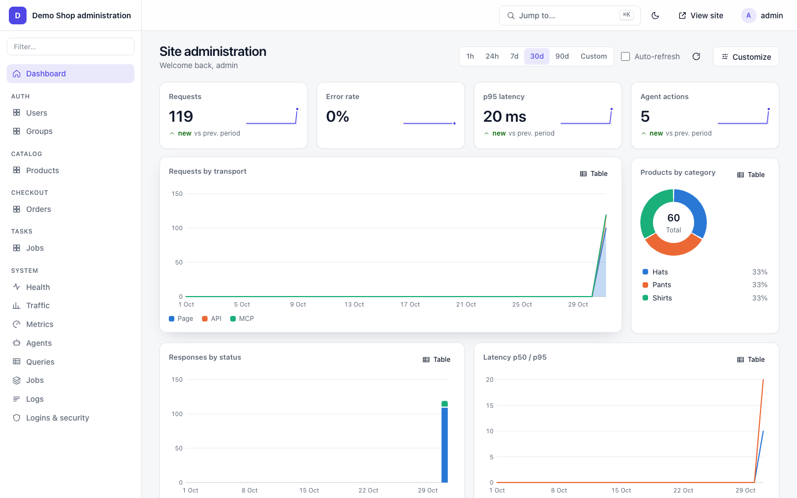
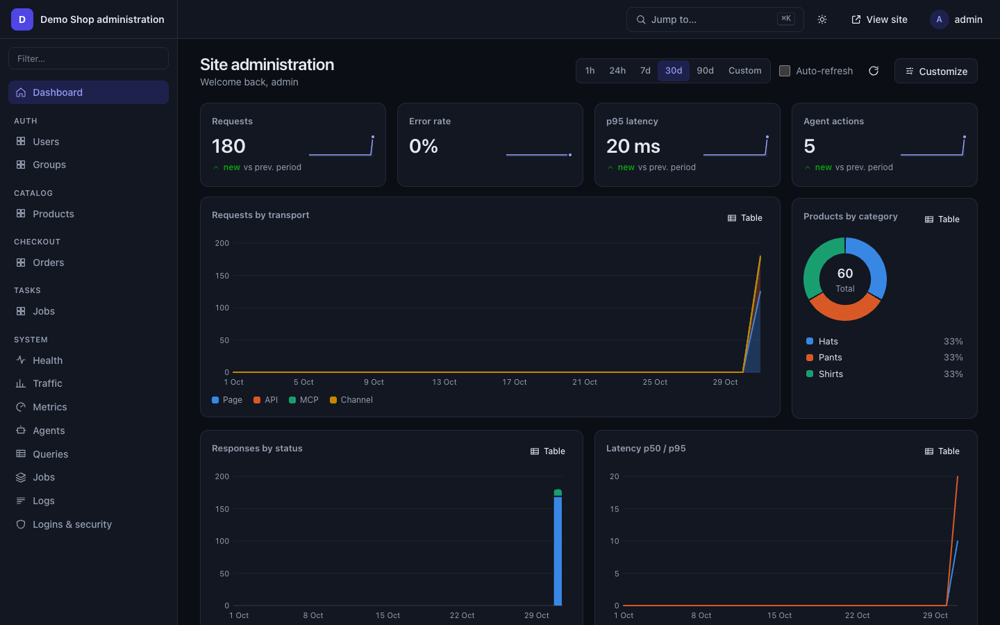
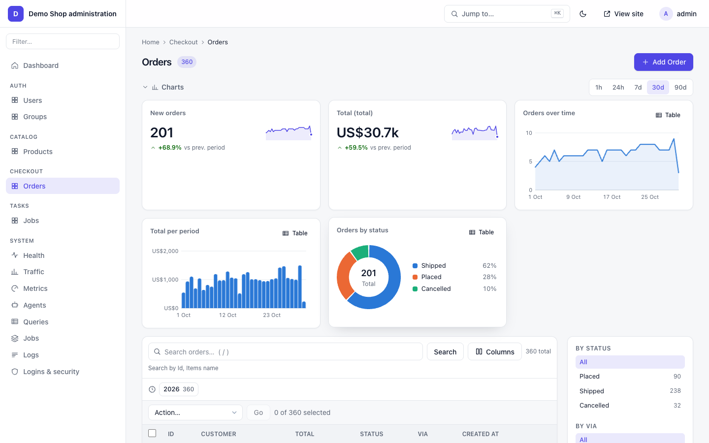
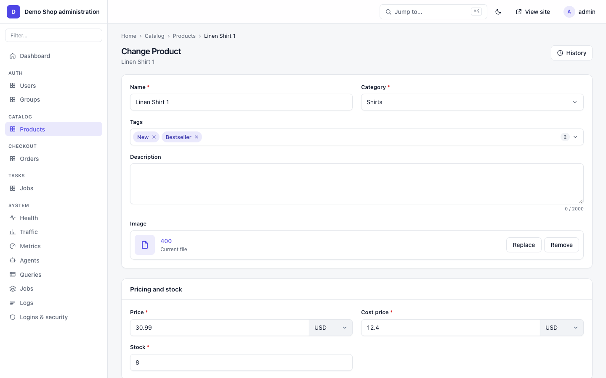
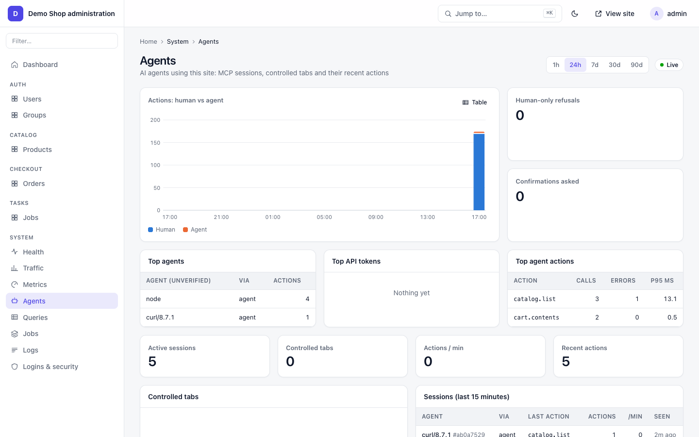
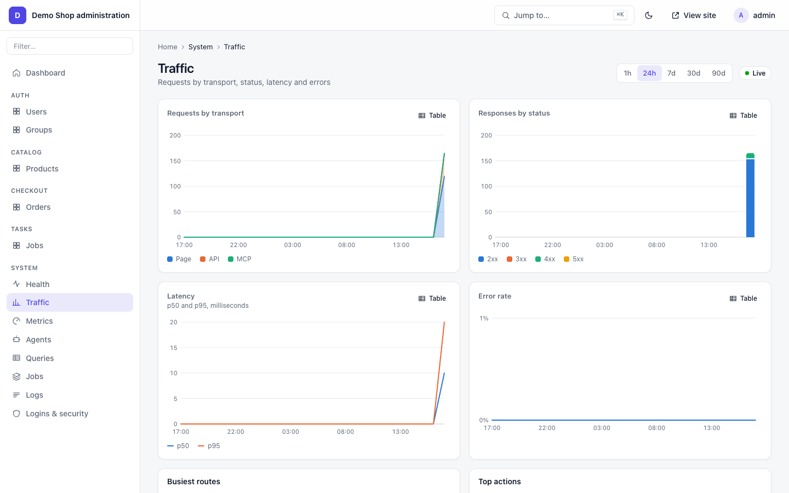
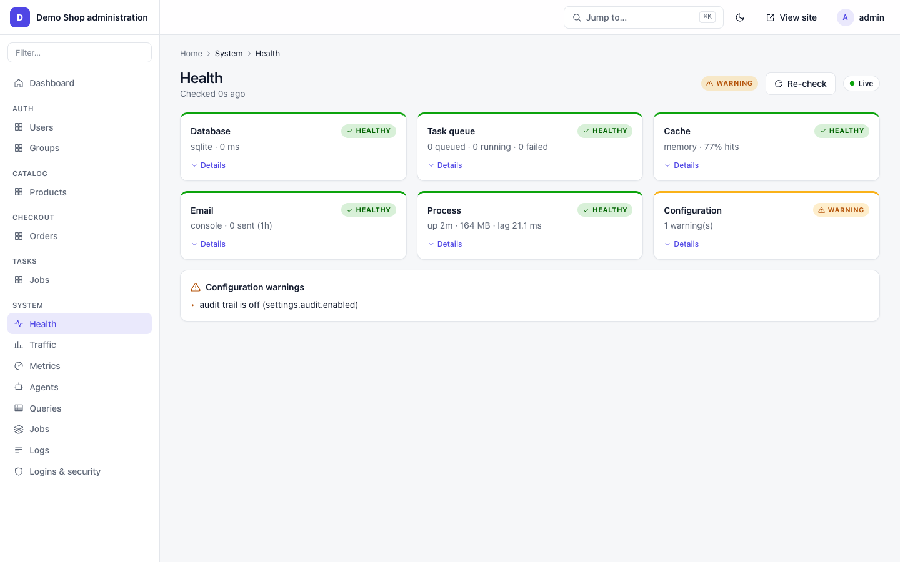
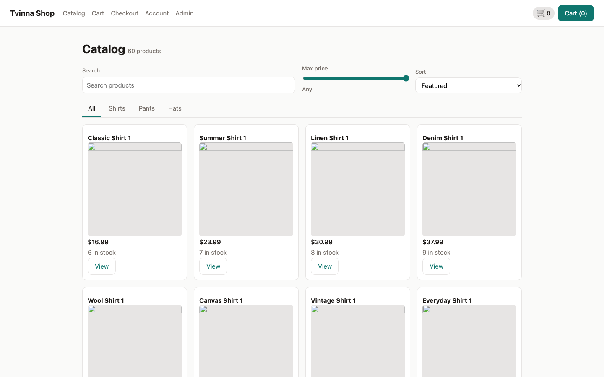
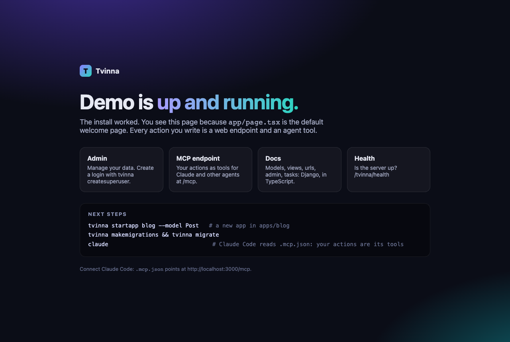
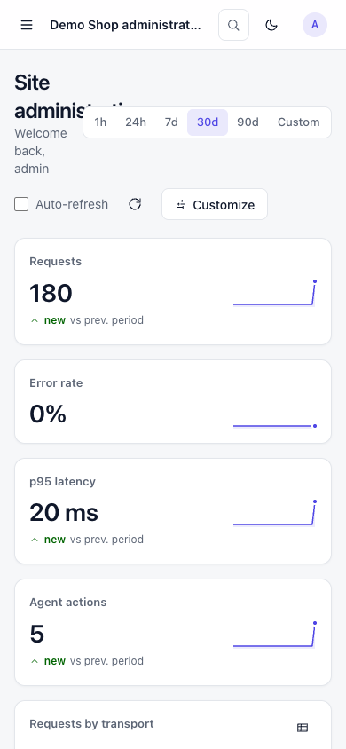

# Tvine

**The agent-native web framework: Django for TypeScript, with Next.js and React, where AI agents use your app through a built-in MCP server (Model Context Protocol) and WebMCP.** Own ORM, migrations, admin panel, auth, background tasks.

[](https://www.npmjs.com/package/tvinejs)
[](LICENSE)
[](https://nodejs.org)
[](https://www.typescriptlang.org)
[](https://nextjs.org)
[](https://react.dev)

npm package name: `tvinejs` (you import it and run it as `tvine`): `npm install tvine@npm:tvinejs`, or `npx tvinejs startproject my-app`.

## Why Tvine

- **People and AI agents use the same app.** Every action you write is also an MCP tool. Every page has a compact JSON view for agents on the same URL.
- **Agents can drive the real UI.** An agent reads the page and clicks its widgets, or asks to control your open tab. You click **Allow**; **Stop** takes it back. You see where it is working.
- **Django, in TypeScript.** Models, migrations, QuerySets, views, serializers, `urls.ts`, auth, admin, tasks, cache, email, audit, middleware. If you know Django, you know where things go.
- **Next.js pages.** React 19 + Next 16 for the frontend, calling the backend through a typed `api.*` client.
- **One Node process.** **Warp** is the server, **Weft** the frontend. Tvine is Icelandic for "twine two threads".
- **Secure by default.** Host allow-list, CSP, CORS, sessions, 2FA, encrypted fields, human-only actions, confirm prompts for agents.

## Screenshots

| | |
|---|---|
|  Admin dashboard |  Dark mode |
|  Changelist with charts |  Change form |
|  System → Agents: who is using your app |  System → Traffic |
|  System → Health |  An example store app built with Weft |
|  `tvine startproject` welcome page |  Admin on mobile |

Screenshots are from an example store app built on Tvine.

## Quick start

Needs Node 22.15+ and pnpm 9.

```bash
git clone https://github.com/zohaib3249/tvine && cd tvine
pnpm install && pnpm -r build
cd examples/notes && pnpm exec tvine migrate
TVINE_SUPERUSER_USERNAME=admin TVINE_SUPERUSER_EMAIL=admin@example.com TVINE_SUPERUSER_PASSWORD='change-me-please-42' pnpm exec tvine createsuperuser --noinput
pnpm exec tvine dev --port 4400
```

- App: http://localhost:4400, admin: http://localhost:4400/admin
- What an agent sees: `curl -H 'x-tvine: 1' http://localhost:4400/`
- `tvine: command not found`? Use `pnpm exec tvine …`, or `npm i -g tvinejs` once (gives the `tvine` command). See [Getting the `tvine` command](docs/installation.md#getting-the-tvine-command).
- New project from scratch: `npx tvinejs startproject my-app`. See [installation.md](docs/installation.md).

**Connect Claude.** Put this `.mcp.json` in the folder where you run `claude`:

```json
{ "mcpServers": { "tvine-notes": { "type": "http", "url": "http://localhost:4400/mcp" } } }
```

Claude Code then lists the app's tools (`read_page`, `ui`, `do`, `request_control`, …). Claude Desktop and more: [agents-and-mcp.md](docs/agents-and-mcp.md).

## How agents use your app

```
            ┌───────────── one Node process ─────────────┐
 Browser ──▶│  Next.js pages (Weft)    /admin            │
            │        │  api.*                            │
 Agent ────▶│  /mcp ─┼─▶ actions (Warp) ─▶ ORM ─▶ DB     │
 (MCP)      │        │                                   │
            │  tab socket ◀── request_control ── Allow   │
            └────────────────────────────────────────────┘
```

| Tool | What it does |
|---|---|
| `read_page` | the page as compact JSON: widgets, labels, data, what can be clicked |
| `expand` | open a part of the page in more detail |
| `ui` | act on a widget: click, fill, select |
| `do` | run an action by id with params (no UI needed) |
| `request_control` / `release` | ask to drive a person's open tab; they click **Allow**, **Stop** ends it |
| `<app>_<action>` | every action you wrote, as its own tool |

Two modes: **headless** (the agent works on the server-rendered page, no browser needed) and **tab control** (it drives the tab a person has open, with a visible agent cursor). Actions marked `humanOnly` refuse every agent path; `confirm` asks first. Details: [agents-and-mcp.md](docs/agents-and-mcp.md).

## Features

| Area | Guide |
|---|---|
| Install, new project, the `tvine` command | [installation.md](docs/installation.md) |
| Settings and environment variables | [settings-and-env.md](docs/settings-and-env.md) |
| Models, ORM (SQLite / Postgres / MySQL), migrations, encrypted fields | [models-and-orm.md](docs/models-and-orm.md) |
| Actions, generic views, `@action`, `urls.ts`, `api.*` client | [views-urls-api.md](docs/views-urls-api.md) |
| Weft widgets, forms, `HumanOnly`, confirm | [frontend-weft.md](docs/frontend-weft.md) |
| MCP, tab control, WebMCP, inspector | [agents-and-mcp.md](docs/agents-and-mcp.md) |
| Admin panel, dashboard, charts, system pages | [admin.md](docs/admin.md) |
| Auth, 2FA, tokens, permissions, security features | [auth-and-security.md](docs/auth-and-security.md) |
| Background tasks, cache, email | [tasks-cache-email.md](docs/tasks-cache-email.md) |
| Testing | [testing.md](docs/testing.md) |
| Every CLI command | [cli.md](docs/cli.md) |
| Production | [deploy.md](docs/deploy.md) |
| Tutorial: a notes app in 15 minutes | [getting-started.md](docs/getting-started.md) |
| All guides | [docs/README.md](docs/README.md) |

## Project layout

```
packages/tvine/     the one npm package `tvinejs` (imported as `tvine`)
  warp/      tvine, tvine/auth, tvine/migrations, …   server: ORM + migrations, views, MCP/HTTP, auth, admin, tasks, CLI
  weft/      tvine/weft, tvine/api, tvine/widgets, tvine/forms   frontend: widgets, api.* client, tab control, WebMCP
  admin/     tvine/admin, tvine/admin.css               the /admin panel UI
  inspect/   tvine/inspect                              dev inspector (tvine inspect)
examples/
  notes/     the getting-started app
docs/        user guides (index: docs/README.md)
```

## Requirements

- Node.js 22.15 or newer
- pnpm 9
- SQLite works out of the box; Postgres and MySQL need `pg` / `mysql2` in your app

## Contributing

Issues and pull requests are welcome. Before a PR:

```bash
pnpm -r build
pnpm -C packages/tvine test
```

Keep changes small, add a test, and update the matching guide in `docs/`.

## License

[MIT](LICENSE)
