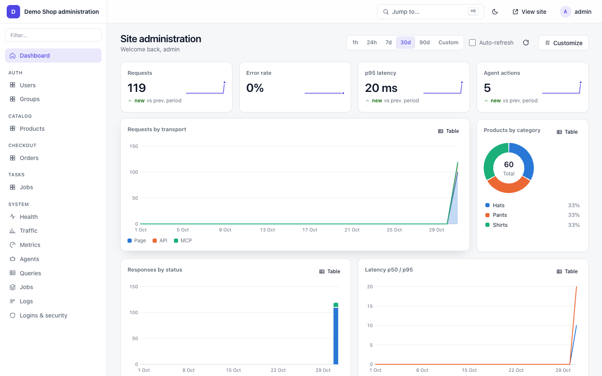
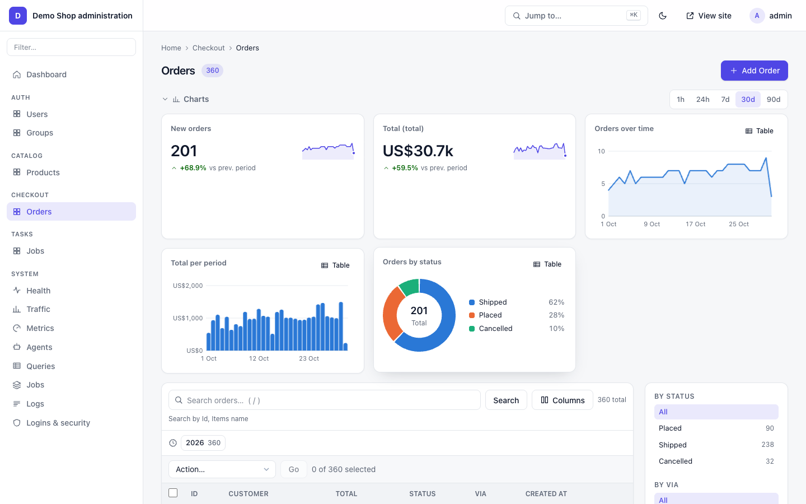
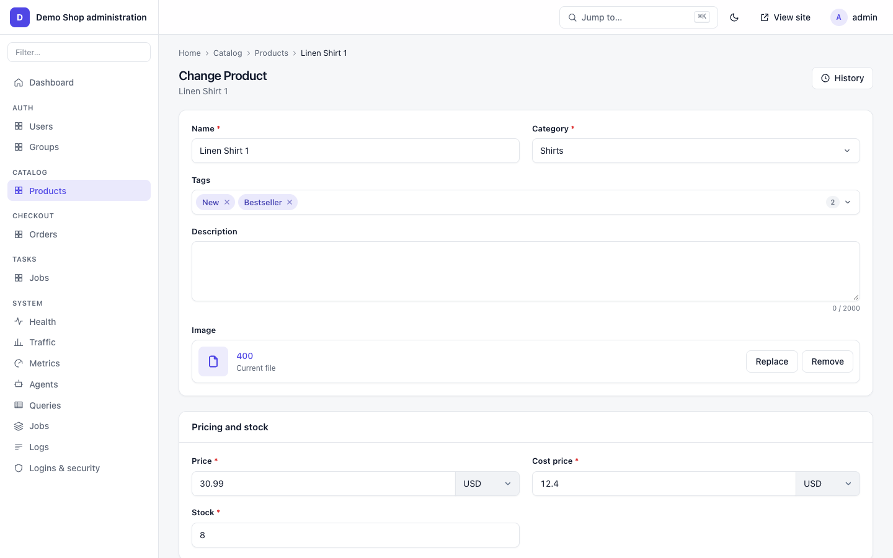
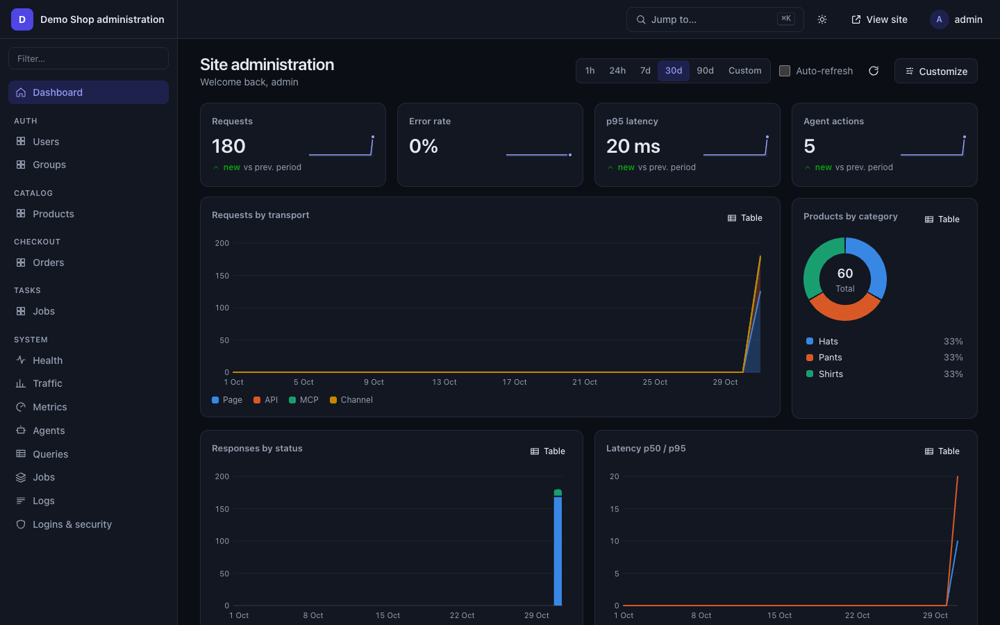
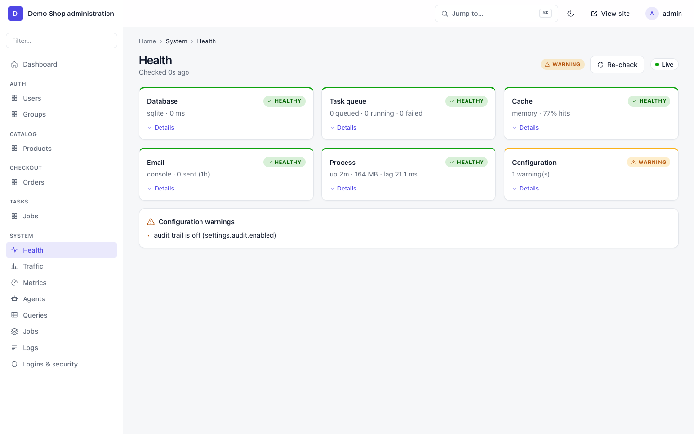
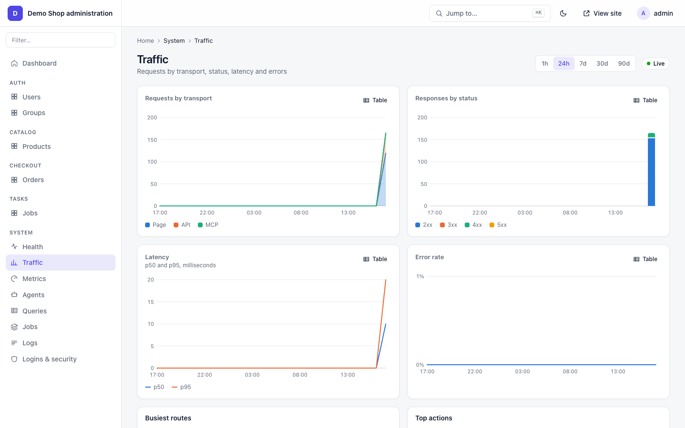
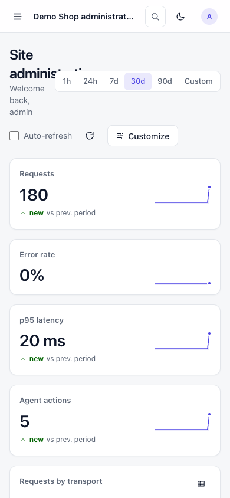

# Admin panel

Tvine ships an admin panel at `/admin`. You register models in `apps/<app>/admin.ts`, and Warp serves a
modern, responsive panel: changelists with filters, search, bulk actions and charts, change forms with inlines,
a dashboard, and a System section (health, traffic, agents, queries, jobs, logs, security).



## Setup

Add `tvine.admin` to `installedApps` (it needs `tvine.auth` for logins) (the panel ships with `tvine`). No page file is needed: Warp serves the panel itself.

```ts
// settings.ts
export default defineSettings({
  installedApps: ['tvine.auth', 'tvine.tasks', 'tvine.admin'],
  admin: { path: '/admin', title: 'Demo Shop admin', theme: { dark: 'auto' } },
})
```

Run the migrations, then make a staff login (in your app folder):

```bash
pnpm exec tvine migrate
TVINE_SUPERUSER_USERNAME=admin TVINE_SUPERUSER_EMAIL=admin@example.com \
TVINE_SUPERUSER_PASSWORD='change-me-please-42' pnpm exec tvine createsuperuser --noinput
# Superuser created successfully.
```

Open `http://localhost:<port>/admin` and sign in.

## Register a model

```ts
// apps/catalog/admin.ts
import { admin, adminAction, display, ModelAdmin } from 'tvine/contrib/admin'
import { Product } from './models.ts'

export const restock = adminAction({ description: 'Restock to 20', permissions: ['change'] }, async (_a, _ctx, qs) => {
  await qs.update({ stock: 20 })
})

export class ProductAdmin extends ModelAdmin {
  listDisplay = ['name', 'category', 'price', 'stock', 'available']
  listFilter = ['category']
  listEditable = ['stock']
  searchFields = ['name']
  ordering = ['name']
  actions = [restock]
  str(p: any) { return String(p.name) }
  available = display({ description: 'Available', boolean: true })((p: any) => p.stock > 0)
}
admin.site.register(Product, ProductAdmin)
```

`tvine.auth` registers User and Group for you; `tvine.tasks` registers Job (read-only, with retry and revoke).
A small working example: [examples/notes/apps/notes/admin.ts](../examples/notes/apps/notes/admin.ts).



## ModelAdmin options

Option names are camelCase.

| Option | Default | What it does |
|---|---|---|
| `listDisplay` | `['__str__']` | columns; field names or functions (wrap with `display({ description, boolean, ordering })`) |
| `listDisplayLinks` | first column | columns that open the row |
| `listEditable` | `[]` | columns edited in place (must be in `listDisplay`, not a link) |
| `listPerPage` / `listMaxShowAll` | `100` / `200` | page size / "show all" cap |
| `listFilter` | `[]` | field names or `SimpleListFilter` classes (sidebar; a drawer on phones) |
| `showFacets` | `true` | counts next to each filter value |
| `searchFields` | `[]` | prefixes: `^` starts with, `=` exact, `@` / none contains; `__` crosses relations |
| `searchHelpText` | `null` | hint under the search box |
| `dateHierarchy` | `null` | a date field: year / month / day drill-down |
| `ordering` / `sortableBy` | `null` | default order / which columns can be sorted |
| `fields` / `exclude` / `fieldsets` | all | what the change form shows; `fieldsets = [[title, { fields, classes: ['collapse'] }]]` |
| `readonlyFields` | `[]` | shown, not editable |
| `autocompleteFields` / `rawIdFields` | `[]` | how fk / m2m fields pick rows |
| `inlines` | `[]` | `TabularInline` / `StackedInline` classes (`model`, `fields`, `extra`, `maxNum`, `minNum`, `canDelete`, `fkName`) |
| `actions` / `actionsOnTop` | `[]` / `true` | bulk actions from `adminAction({ description, permissions, confirm, humanOnly }, fn)`; `deleteSelected` is built in |
| `saveOnTop` | `false` | save buttons above the form too |
| `showFullResultCount` | `true` | "5 of 360" when filtered |
| `emptyValueDisplay` | `'-'` | shown for empty cells |
| `widgets` | `{}` | form widget per field: `{ status: 'segmented', notes: 'markdown' }` |
| `formfieldOverrides` | `{}` | field meta per field name or ORM kind: `{ text: { kind: 'textarea' } }` |
| `charts` | `null` | `null` automatic, `false` none, or a list (see Charts) |
| `agents` | `true` | `false`: agents may not use this model; `'confirm'`: an agent's writes need the human to confirm |
| `verboseName` / `verboseNamePlural` | from the model | labels |

Methods you can override: `getQueryset(ctx)` (scope rows per user), `hasViewPermission` / `hasAddPermission` /
`hasChangePermission` / `hasDeletePermission(ctx, obj?)`, `saveModel`, `deleteModel`, `getActions`,
`getUrls()` (custom admin views), `str(obj)`.

## Forms and widgets

The change form is generated from the model's field types: text, numbers, money, dates, choices, fk / m2m pickers,
tags, color, file and image drop zones, markdown, code, JSON, and more. Pick a different widget per field with
`widgets`; the full list of kinds is in [frontend-weft.md](frontend-weft.md#input-kinds).



## Dashboard

`/admin` opens on a dashboard. Built-in widgets (on while `admin.stats.enabled`):

| Widget | Shows |
|---|---|
| KPI tiles | requests, errors, latency, agents |
| Traffic | requests over time, status codes, latency p50 / p95 |
| Logins | sign-ins and failures (superusers) |
| Agents | agent activity and the busiest agents |
| Actions | most used and slowest actions |
| Queries | the heaviest SQL statements |
| Top searches | the most frequent search terms |
| Most visited pages | the pages with the most views |
| Recent activity | your latest admin changes |
| Model charts | automatic charts per registered model (see Charts) |

Each staff user can reorder, hide and resize widgets; the layout is saved per user. Pick a range (1 h to 1 y) at
the top; 1 h reads live in-memory numbers, longer ranges read hourly rollups stored in the `admin_stat` table.



Add your own widget:

```ts
admin.site.registerWidget({
  id: 'low-stock', title: 'Running low', size: 'md', type: 'table',
  data: async () => {
    const rows = await Product.objects.filter({ stock__lt: 8 }).order('stock', 'name').all(8)
    return { columns: ['Product', 'Category', 'Stock'], rows: rows.map((p) => [p.name, p.category, p.stock]) }
  },
})
```

`size`: `sm | md | lg | xl`. `type`: `line | area | bar | stacked | donut | stat | table`. Optional `refreshMs`
and `permission` (a codename).

## Charts

Every changelist has a chart strip, and model charts also appear on the dashboard.

- `charts = null` (default): automatic. A count + area chart on the date field, a sum + bar chart on the first
  money field, donuts for the first choice / boolean / fk fields.
- `charts = false`: none.
- Your own list:

```ts
charts: ModelAdmin['charts'] = [
  { id: 'by_category', type: 'donut', by: 'category', title: 'Products by category' },
  { id: 'stock', type: 'bar', by: 'category', aggregate: 'sum', field: 'stock', title: 'Units in stock' },
]
```

Spec keys: `id, title, type, aggregate (count|sum|avg|min|max), field, by, date, range, size, dashboard`.
Charts use the changelist's queryset and filters, so `getQueryset` scoping applies. Results are cached 60 s per user.

## System pages

Under **System** in the sidebar (`/admin/system/<page>/`):

| Page | Shows | Who |
|---|---|---|
| Health | database latency, pending migrations, Redis, task queue, cache hit rate, mail, memory, event-loop lag, config warnings | staff |
| Traffic | requests, status codes, latency per route | staff |
| Metrics | counters and histograms | staff |
| Agents | connected agents and controlled tabs; **Stop** ends an agent's tab control | staff (Stop: superuser) |
| Queries | slow and frequent SQL | staff |
| Jobs | background jobs (`tasks.view_job`) | staff |
| Logs | live log stream | superuser |
| Logins & security | sign-ins, lockouts, security events | superuser |




The pages update live over `/tvine/channel?group=admin:live`.

## Customize

- Site: `admin.site.siteHeader`, `siteTitle`, `indexTitle`, `siteUrl`.
- Theme: `settings.admin.theme = { brand, radius, dark: 'auto' | 'on' | 'off' }`.
- Custom pages: `admin.site.registerPage({ path: 'reports/', title, icon, section, component: 'module#Export' })`.
- Custom admin views: `getUrls()` on a ModelAdmin.
- Own Next page: put `app/admin/[[...path]]/page.tsx` exporting `tvine/admin/page` and use
  `configureAdmin({ components, slots })` to plug in your own React components.

The panel is phone-friendly: the sidebar and filters become drawers.



## Settings

```ts
admin: {
  path: '/admin',
  title: 'My admin',
  theme: { brand: '#4f46e5', radius: '12px', dark: 'auto' },
  allowIps: ['10.0.0.0/8'],      // staff may only use the admin from these addresses
  require2fa: true,              // staff must turn on TOTP first
  idleMs: 15 * 60_000,           // staff idle sign-out
  dashboard: { widgets: [], autoCharts: true },             // widget ids first, in order
  stats: { enabled: true, retentionDays: 30, flushMs: 60_000 },
}
```

## The admin API

The panel talks to the server only through `admin.*` actions (`admin.site`, `admin.meta`, `admin.list`,
`admin.get`, `admin.create`, `admin.update`, `admin.delete`, `admin.action`, `admin.dashboard`, `admin.chart`,
`admin.system.health`, …). You can call them yourself with a staff session (`x-tvine-api: 1` marks a browser-style
API call; params go under `params`):

```bash
curl -s -c jar -b jar -X POST http://localhost:4631/tvine/api/auth.login \
  -H 'content-type: application/json' -H 'x-tvine-api: 1' \
  -d '{"params":{"username":"admin","password":"change-me-please-42"}}'
# {"ok":true,"data":{"id":"1","username":"admin",…,"isStaff":true,"isSuperuser":true}}
curl -s -b jar -X POST http://localhost:4631/tvine/api/admin.system.health \
  -H 'content-type: application/json' -H 'x-tvine-api: 1' -d '{}'
# {"ok":true,"data":{"status":"warn","sections":[{"name":"db","title":"Database","status":"ok",…
```

Agents use the same actions as MCP tools, under the same staff and model permissions.

## Gotchas

- Every panel screen makes 2 to 4 API calls, which count against `limits.rate` (60/min per session by default).
  The demo raises it to 300.
- A boot error names the class when `listDisplay`, `listFilter`, `searchFields` or an inline points at a field that
  does not exist. Fix the name; nothing is silently ignored.
- An agent GET of `/admin` returns 404 "no agent view": agents use the `admin.*` tools, or drive a human's tab after
  **Allow** (every admin control is a Weft widget with a stable id).
- `=` search is case-sensitive.
