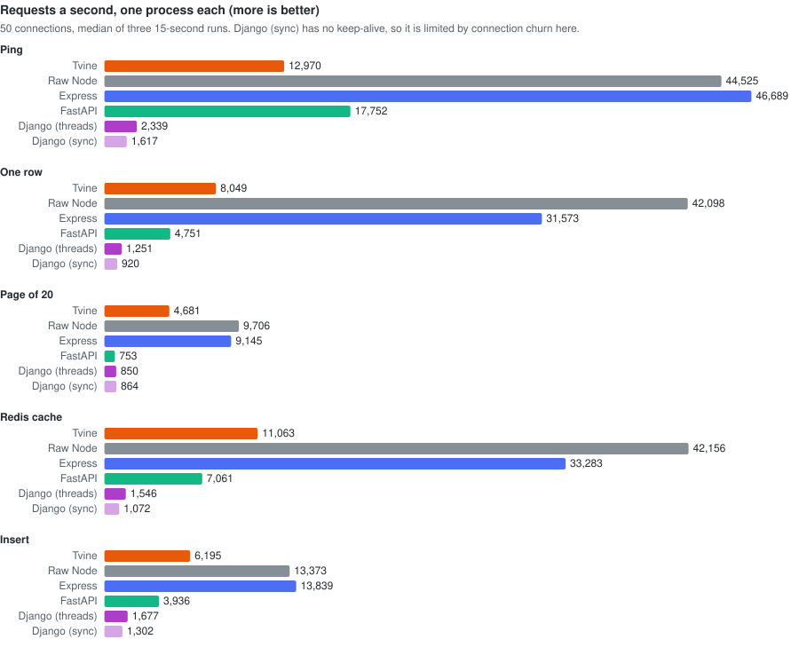
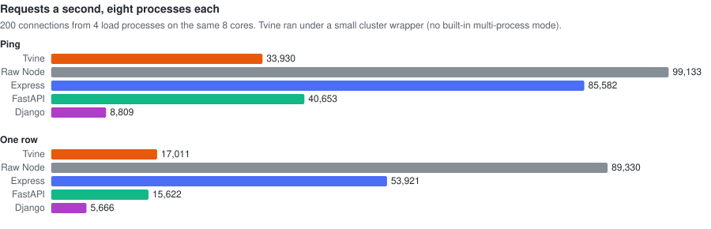
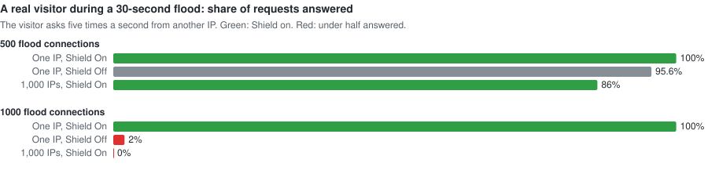
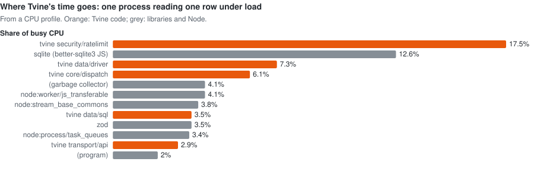

# Benchmark

The same JSON API written in Tvine, raw Node, Express, FastAPI and Django, measured on one laptop. The code and the raw
results are in [`benchmarks/`](../benchmarks/README.md), so you can rerun everything with one command.

**Interactive page:** [docs/benchmark.html](benchmark.html), one self-contained file with every chart, hover details and the full tables. Download it and open it in a browser, or [view it rendered](https://htmlpreview.github.io/?https://github.com/zohaib3249/tvine/blob/main/docs/benchmark.html).

## In short

- **Against Django:** Tvine is faster on every endpoint, 3–6× on one process.
- **Against FastAPI:** Tvine is faster on everything that touches the database. On a page of 20 rows it is 6×
  faster, and its insert p99 is 10× lower. FastAPI wins only on `ping`, which touches nothing.
- **Against Express:** Express is 2–4.6× faster on raw throughput. The benchmark Express app does only the query and
  the JSON. Tvine also validates input, keeps sessions, marks agents and serves every action over MCP. A CPU profile
  shows where most of the gap comes from, and both causes are fixable (see [where the time goes](#where-tvines-time-goes)).
- **Shield** costs about 16–19% of throughput. During a flood from one IP, a real visitor kept 100% of their
  requests answered. Without Shield, they kept 2%. A flood spread over 1,000 IPs is not stopped by per-IP limits.

## The test

| | |
|---|---|
| Machine | Apple M1 Pro, 8 cores, 16 GB; the load tool runs on the same machine |
| Versions | tvinejs 0.3.1 (Next 16.4.2), Express 5.3.0, FastAPI 0.162.0 + uvicorn 0.54.0, Django 5.2.18 + gunicorn 26.2.0, Node 26.0.0, Python 3.14.6, Redis 7.2.5 |
| Data | the same 10,000 rows in SQLite (WAL) in every app; identical JSON responses, checked before timing |
| Endpoints | `GET /api/ping`, `GET /api/items/<id>` (one row), `GET /api/items?limit=20&offset=n` (a page), `GET /api/cached/<id>` (Redis, then the database on a miss), `POST /api/items` (insert) |
| Main runs | one process each, production mode, 50 connections, 5 s warm-up, then three 15-second runs; the median is kept |
| Tvine settings | `tvine start`; Shield and the framework's general rate limit off for the speed runs |

## One process

| Endpoint | Tvine | Raw Node | Express | FastAPI | Django (threads) | Django (sync) |
|---|---|---|---|---|---|---|
| Ping | 11,765 · p99 8 ms | 44,525 · 2 ms | 48,884 · 1 ms | 17,752 · 5 ms | 2,339 · 43 ms | 1,617 · 4.6 s |
| One row | 7,417 · 14 ms | 42,098 · 2 ms | 33,859 · 2 ms | 4,751 · 17 ms | 1,251 · 109 ms | 920 · 5.4 s |
| Page of 20 | 4,621 · 22 ms | 9,706 · 10 ms | 9,478 · 10 ms | 753 · 113 ms | 850 · 129 ms | 864 · 5.6 s |
| Redis cache | 7,976 · 12 ms | 42,156 · 2 ms | 35,337 · 3 ms | 7,061 · 22 ms | 1,546 · 87 ms | 1,072 · 6.0 s |
| Insert | 4,844 · 20 ms | 13,373 · 20 ms | 12,941 · 17 ms | 3,936 · 202 ms | 1,677 · 106 ms | 1,302 · 4.8 s |

Requests a second and p99 latency. Raw Node and Express reach the load tool's own limit on ping, one row and the cache,
so their real ceiling may be higher. Django's sync worker closes the connection after every response, so on this
machine it is limited by opening new connections.

## Eight processes

| | Raw Node | Express | Tvine | FastAPI | Django |
|---|---|---|---|---|---|
| Ping | 99,133 | 85,582 | 33,930 | 40,653 | 8,809 |
| One row | 89,330 | 53,921 | 17,011 | 15,622 | 5,666 |

200 connections from four load processes on the same eight cores. Tvine has no built-in multi-process mode yet; it ran
under a small `node:cluster` wrapper. Each Tvine process carries Next.js as well, so eight of them used 1.5–1.9 GB.

At a fixed request rate, eight Express processes held 25,000 requests a second with p99 under 13 ms, and passed
50,000 on a retry. Eight Tvine processes passed 5,000 but with p99 around 170–190 ms, and failed at 10,000. 100,000 a
second was not reachable on this laptop: the load processes ran out of CPU first.

## Shield

| | Off | On | Change |
|---|---|---|---|
| Ping, req/s | 10,650 | 8,604 | −19% |
| One row, req/s | 7,154 | 6,011 | −16% |

Measured from 20,000 rotating IPs so the rate limit never fired: this is the cost of the checks alone.

**Agents over MCP** (no errors in any run):

| Tool | 50 agents | 200 agents |
|---|---|---|
| `read_page`, Shield on | 3,333 req/s | 2,353 req/s |
| `read_page`, Shield off | 3,748 req/s | 2,150 req/s |
| an action tool, Shield on | 1,594 req/s | 1,348 req/s |
| an action tool, Shield off | 1,669 req/s | 1,844 req/s |

### Floods

A 30-second flood against one-row reads while a separate visitor, on another IP, asks five times a second.

| Flood | Server answered | Turned away | Visitor answered | Visitor p50 |
|---|---|---|---|---|
| One IP, 1,000 connections, Shield on | 19,297 req/s | 99.9% | **100%** | 73 ms |
| One IP, 1,000 connections, Shield off | 7,073 req/s | – | **2%** | 8.5 s |
| 1,000 IPs, 1,000 connections, Shield on | 6,304 req/s | 0% | **0%** | – |
| One IP, 500 connections, Shield on | 21,151 req/s | 99.9% | 100% | 36 ms |
| One IP, 500 connections, Shield off | 6,991 req/s | – | 95.6% | 103 ms |
| 1,000 IPs, 500 connections, Shield on | 6,100 req/s | 0% | 86% | 123 ms |

Turning a request away costs far less than serving it, so a flood from one IP is absorbed and the visitor keeps getting
pages. A flood spread over 1,000 IPs keeps every IP under the per-IP limit, so the single process fills up. Stopping that
needs a whole-site emergency mode and more processes, which are on the roadmap.

## Where Tvine's time goes

A CPU profile of one Tvine process reading one row at full load:

| Cause | Share | Fix |
|---|---|---|
| Rate-limit bookkeeping | 17.5% | every anonymous request gets a new throwaway session, so the per-session limiter map stays full and evicts on every request; key anonymous requests by IP and create sessions only when used |
| Compiling SQL again on every query | 12.6% | cache prepared statements |
| ORM driver, SQL building, queryset | ~12% | fewer allocations on the hot path |
| Request dispatch (session copy, validation) | ~11% | avoid copying session data that is not used |
| HTTP middleware, Next.js routing | ~1% each | none needed |

## Caveats

- One laptop: the load tool and the servers share the same cores, with a little background load. Read the numbers as
  this machine's limits, not a production ceiling.
- SQLite rather than Postgres; Redis on the same machine.
- Tvine ran as a full app with Next.js and security headers in the same process. Express, FastAPI and raw Node ran with
  no security middleware.
- The scale, eight-process, MCP and flood results are single runs.
- Under the Redis and insert tests, Tvine's memory grew from about 390 MB to 2.6 GB (the per-request sessions above).
  That fix is in progress.
